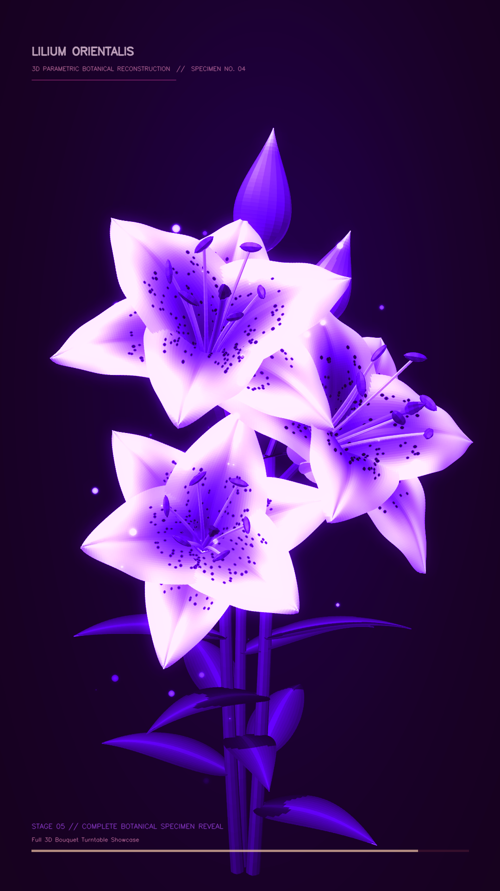

# Neon Purple Lily Animation 🌸

A Python-generated 3D-style animated Oriental lily bouquet, recolored in Errorythm's neon-purple visual theme. The animation is rendered as a vertical video suitable for Reels and YouTube Shorts.

<p align="center">
  
</p>

## Features

- Three animated Oriental lilies with buds, stems, leaves, petals, and stamens
- Midnight-purple background with electric-violet and lavender highlights
- Floating particles and botanical-style HUD details
- Vertical output: **1080 × 1920**
- Frame rate: **30 FPS**
- Duration: **13 seconds**
- MP4 encoding with H.264 through FFmpeg

## Requirements

- Python 3.10 or newer
- NumPy
- OpenCV for Python
- FFmpeg installed and available on your system `PATH`

## Installation

Clone the repository and open its folder:

```bash
git clone https://github.com/YOUR-USERNAME/errorythm-neon-purple-lily.git
cd errorythm-neon-purple-lily
```

Install the Python packages:

```bash
py -m pip install -r requirements.txt
```

Check that FFmpeg is available:

```bash
ffmpeg -version
```

## Run the animation

Render the complete MP4:

```bash
py errorythm_lily_neon_purple.py
```

The video is saved in the project folder as `lily_3d_botanical_animation.mp4`.

Render preview keyframes instead:

```bash
py errorythm_lily_neon_purple.py --preview
```

Preview frames are saved in a `lily_preview/` folder.

## Project structure

```text
errorythm-neon-purple-lily/
├── errorythm_lily_neon_purple.py
├── preview.png
├── requirements.txt
├── .gitignore
└── README.md
```

## Troubleshooting

- **`ffmpeg` is not recognized:** install FFmpeg and add its `bin` directory to the Windows `PATH`, then reopen the terminal.
- **Missing Python packages:** run `py -m pip install -r requirements.txt`.
- **Use the Python launcher on Windows:** `py` is used in the commands above. On other systems, replace it with `python3` if needed.

## Creator

Made for **Errorythm** — Build. Break. Rebuild.

Instagram: [@errorythm_](https://www.instagram.com/errorythm_/)
